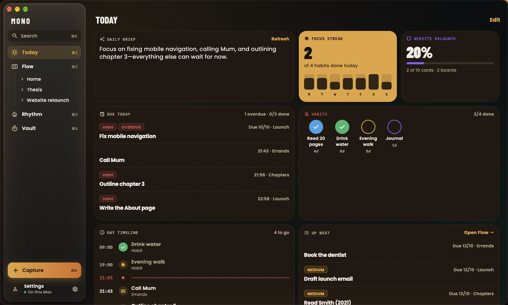
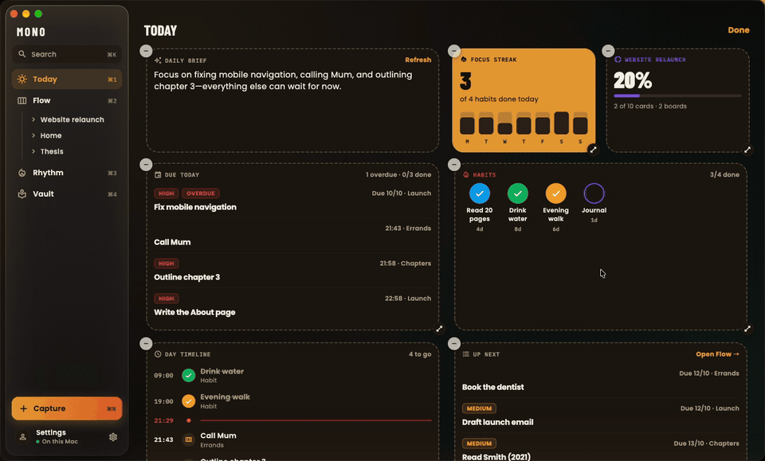
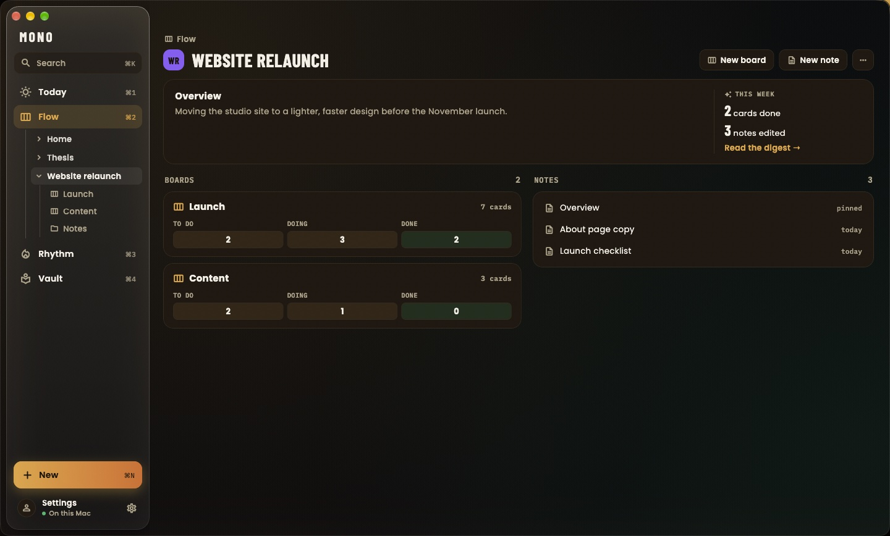
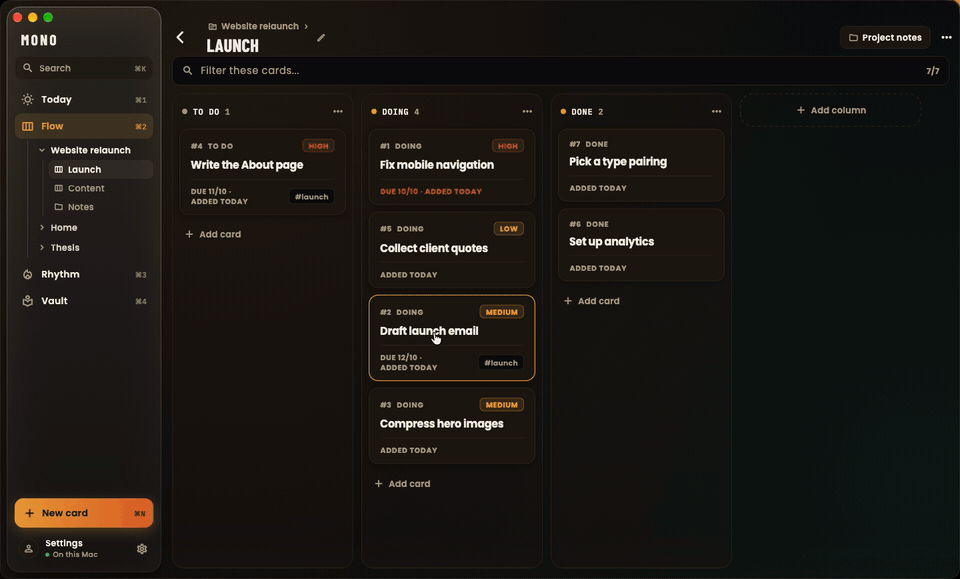
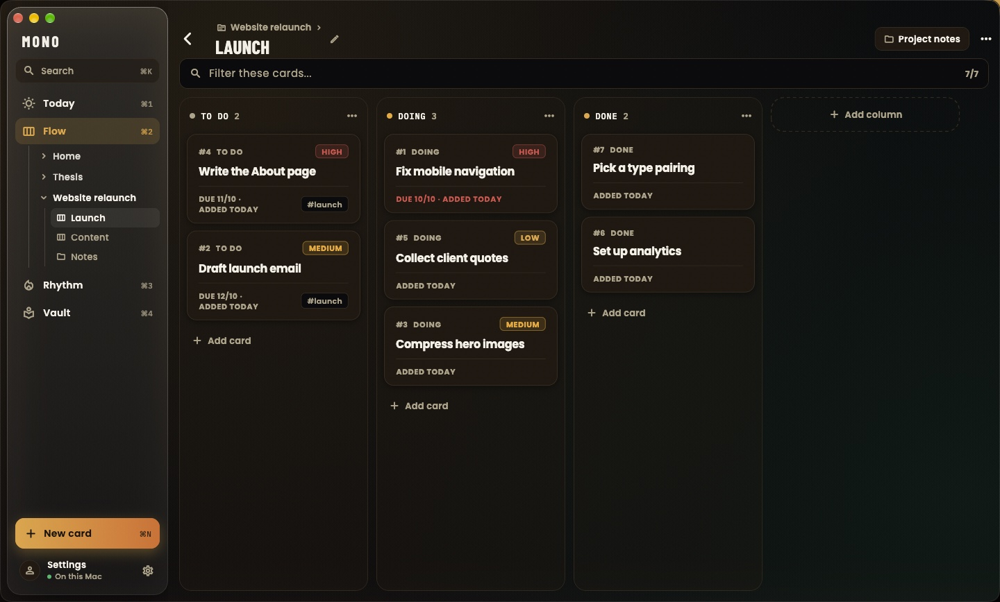
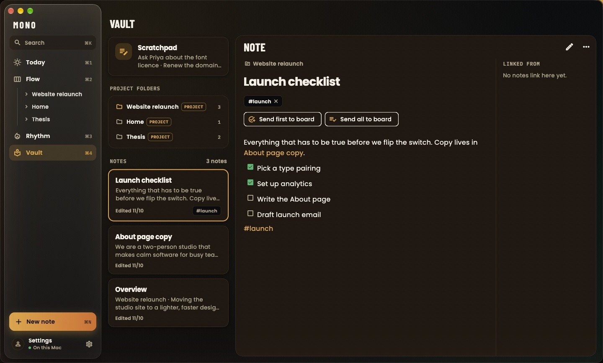
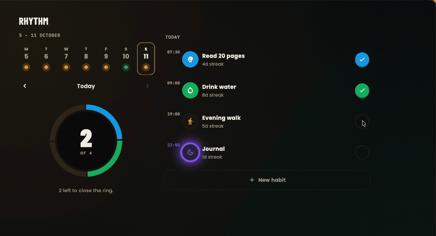
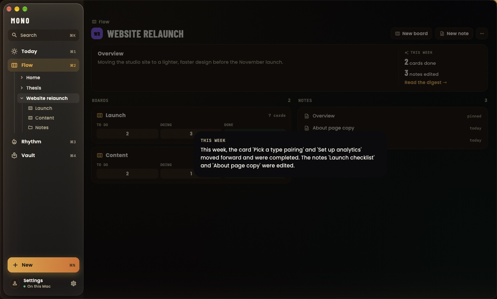

# Mono

**A calm place for your projects, tasks, notes and habits. On your Mac, and only on your Mac.**

[**Download the latest beta**](https://github.com/lakshya-aggarwal/mono-beta/releases/latest) · [Report a bug or share an idea](https://github.com/lakshya-aggarwal/mono-beta/issues/new) · [What's new](https://github.com/lakshya-aggarwal/mono-beta/releases)

<picture>
  <source media="(prefers-color-scheme: light)" srcset="media/today-light.jpg">
  
</picture>

Mono (The Mono System) brings Boards, Notes and Habits together in one quiet app. Group them into Projects, see what matters on a Today screen you arrange yourself, and keep your notes as plain Markdown files on your own disk. There is no account, no sync and nothing to sign up for.

> [!NOTE]
> Mono is in **public beta**. It is stable enough for daily use, but keep a backup of anything important, and please [tell us](#feedback) when something feels off.

## Contents

- [Install](#install)
- [A tour](#a-tour)
  - [Today, arranged your way](#today-arranged-your-way)
  - [Projects](#projects)
  - [Boards](#boards)
  - [Notes](#notes)
  - [Rhythm, for habits](#rhythm-for-habits)
  - [Written on your Mac](#written-on-your-mac)
  - [Everything else](#everything-else)
- [Keyboard shortcuts](#keyboard-shortcuts)
- [Your data and privacy](#your-data-and-privacy)
- [Updating](#updating)
- [Feedback](#feedback)
- [Known limits](#known-limits)
- [FAQ](#faq)

## Install

**You need** a Mac running macOS 12 Monterey or later. The on-device writing features need macOS 26 with Apple Intelligence turned on.

1. Download `The-Mono-System-<version>-macos.zip` from the [latest release](https://github.com/lakshya-aggarwal/mono-beta/releases/latest).
2. Open the zip and drag **The Mono System** into your **Applications** folder.
3. Open it. The beta is not notarised by Apple yet, so the first time macOS may say it cannot check the app:
   - open **System Settings > Privacy & Security**,
   - scroll down to the message about The Mono System,
   - choose **Open Anyway**, then confirm.

You only do this once. After that, Mono opens like any other app.

## A tour

### Today, arranged your way

Today is a grid of widgets. Keep the ones you use, drop the rest, and drag them into the order that suits your morning. Choose **Edit Today** from the View menu, or press and hold any widget.

Each widget can be resized and customised: pick which Board or Project it follows, how many rows it shows, its title and its tint. Widgets you can add:

| Widget | What it shows |
| :-- | :-- |
| **Daily brief** | Two sentences on your day, written on your Mac |
| **Due today** | Cards due today, overdue ones first |
| **Up next** | What is still open, by due date or by priority |
| **Day timeline** | Today by the clock: timed cards, habits and reminders, with a line for now |
| **Week ahead** | The next seven days and what is due on each |
| **Focus streak** | How many of today's habits are done, and how the week went |
| **Habits** | Check off today's habits without leaving Today |
| **Habit heatmap** | One habit, or all of them, over the past weeks |
| **Project progress** | A Project's Boards and how much of each is done |
| **Project digest** | A Project's week, written on your Mac |
| **Board glance** | One Board's columns at a glance |
| **Upcoming reminders** | The next reminders to fire, and what they are for |
| **Done today** | What you finished today |
| **Recent notes**, **Pinned note**, **Scratchpad**, **Tag** | Your writing, a tap away |
| **Quick capture** | A new card, note or habit in one click |

### Projects

A Project holds everything for one piece of work: its Boards, a folder of Notes, and an Overview that says what it is for. The Project page shows how the week went at a glance.

### Boards

Boards are simple kanban: columns, cards, priorities, due dates, tags and repeating cards. Drag a card to another column and it springs into place. Drop it in Done and it is done.

More about cards

- **Priority** (low, medium, high) and **due dates**, with overdue cards called out on Today.
- **Repeating cards**: complete one and the next appears.
- **Reminders** that notify you, with Complete and Snooze right in the notification.
- **#tags** shared with Notes; open a tag to see everything that carries it.
- **Filter** a Board as you type, and archive what you are finished with. Archive keeps it, and you can restore it later.

### Notes

Notes are Markdown. Choose a folder in **Settings > Notes Folder** and every note becomes a real `.md` file there, so it opens in any editor and backs up with anything you already use. Link notes with `[[double brackets]]`, see what links back, and tag them with `#tags`.

**Linked to-dos** turn a checklist line into a Card on a Board, and keep the two in step: tick either one and the other follows.

The **Scratchpad** is always one click away for anything you want to jot down before deciding where it goes.

### Rhythm, for habits

Rhythm tracks habits with a ring for today, a streak for each habit and a week strip above. Check one off and watch the ring close.

Habits can run daily, on weekdays or a few times a week, with their own colour, icon, time and reminder.

### Written on your Mac

Where Apple Intelligence is available, Mono writes two things for you, entirely on your Mac:

- a **Daily brief** on Today that says what matters first and what can wait,
- a **Project digest** that sums up a Project's week: which cards moved, what got done and which notes changed.

Nothing you write is sent anywhere to do this. Where Apple Intelligence is off, or does not support your language yet, these features stay hidden.

### Everything else

- **Search** everything (notes, cards, boards, habits) with <kbd>⌘</kbd> <kbd>K</kbd>. Add `#tag` to narrow it down.
- **Two themes**: High Clarity (light) and Espresso (dark), or follow your Mac.
- **Import** a folder of Markdown notes; **export** your notes, a Board as Markdown, or everything as JSON.
- **Shortcuts and Siri** can open a Project or summarise one.
- **AI tools on your Mac** (anything that speaks MCP) can work with your Projects through a local connection. It only listens on your own Mac, needs a pairing token from Settings, and asks before it changes anything.

## Keyboard shortcuts

| Shortcut | Does |
| :-- | :-- |
| <kbd>⌘</kbd> <kbd>1</kbd> to <kbd>⌘</kbd> <kbd>4</kbd> | Today, Flow, Rhythm, Vault |
| <kbd>⌘</kbd> <kbd>N</kbd> | New card, note, habit or Project, depending on where you are |
| <kbd>⌘</kbd> <kbd>K</kbd> | Search |
| <kbd>⌘</kbd> <kbd>,</kbd> | Settings |
| <kbd>Esc</kbd> | Leave Edit Today, close a sheet |

## Your data and privacy

- Everything stays on your Mac. There is no account, no cloud and no analytics.
- Boards, cards and habits live in a database inside the app's own sandbox. Notes live there too, until you pick a folder in **Settings > Notes Folder**; from then on they are Markdown files in that folder.
- The app only goes online when you ask it to: **Check for updates** and **Send feedback** open pages on GitHub in your browser.

## Updating

**Settings > About > Check for updates** opens the [Releases page](https://github.com/lakshya-aggarwal/mono-beta/releases). Download the newer zip and replace the app in Applications. Your data stays where it is.

Updates do not install themselves in this beta yet.

## Feedback

This is a beta, and your feedback shapes what comes next.

- In the app: **Settings > About > Send feedback**, or **Help > Send feedback**. It opens a new issue here with your app and macOS versions filled in. Nothing is sent until you press Submit.
- Or [open an issue](https://github.com/lakshya-aggarwal/mono-beta/issues/new) yourself. Please say what you did, what you expected and what happened instead. A screenshot helps a lot.

You need a free GitHub account to open an issue. Issues here are public, so leave out anything private.

## Known limits

- Mac only for now: no iPhone app, and no sync between devices.
- The app is not notarised yet, hence the one-time **Open Anyway**.
- Updates are downloaded by hand.

## FAQ

<b>macOS says the app "cannot be opened" or is "damaged".</b>

That is macOS being careful with an app that is not notarised yet. Use **System Settings > Privacy & Security > Open Anyway**, as in [Install](#install). If it says "damaged", move the app to Applications first, then try again.

<b>I don't see the Daily brief or Project digest.</b>

They need macOS 26 with Apple Intelligence turned on, in a language it supports. Without that, Mono hides them rather than offer something that cannot work.

<b>Where are my notes?</b>

If you have chosen a folder in **Settings > Notes Folder**, they are ordinary `.md` files there. If not, they are kept inside the app until you choose one.

<b>Is the source code available?</b>

Not at the moment. This repository is where the beta builds, release notes and feedback live.

The Mono System beta · made with care on a Mac

